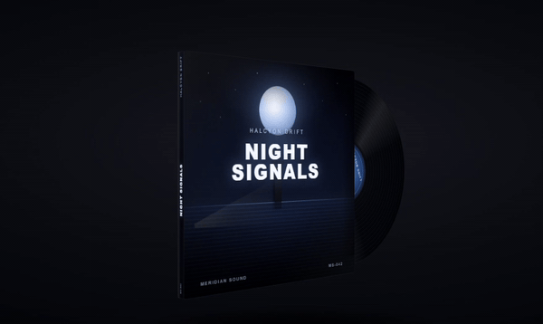
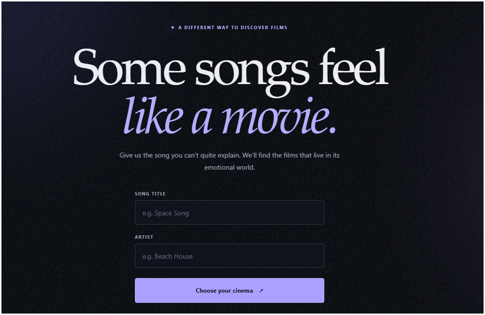
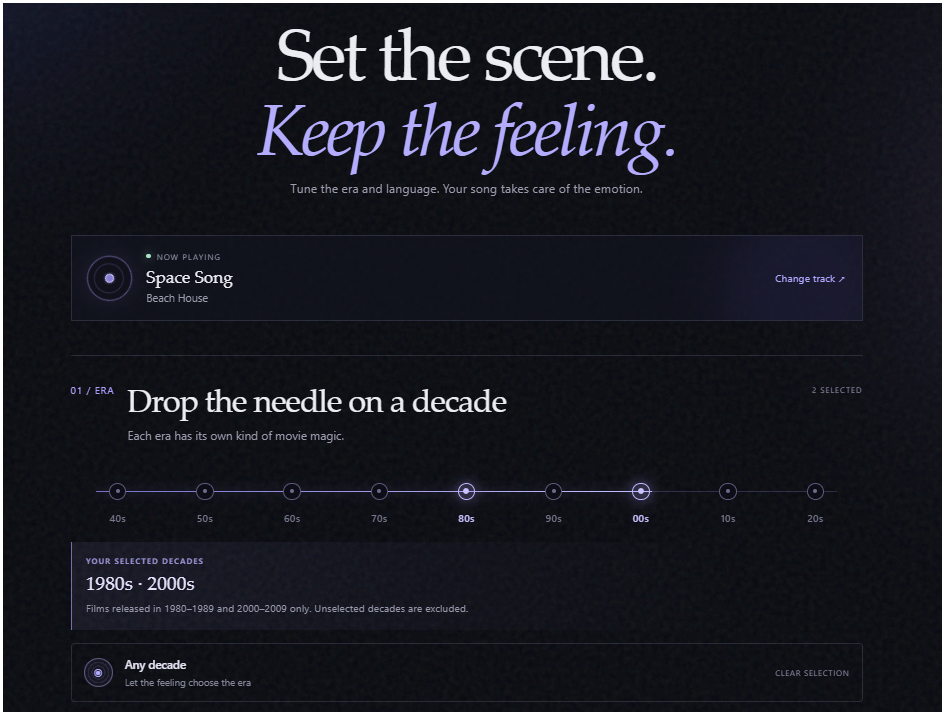
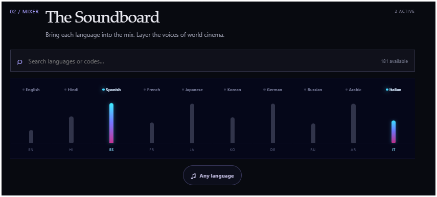
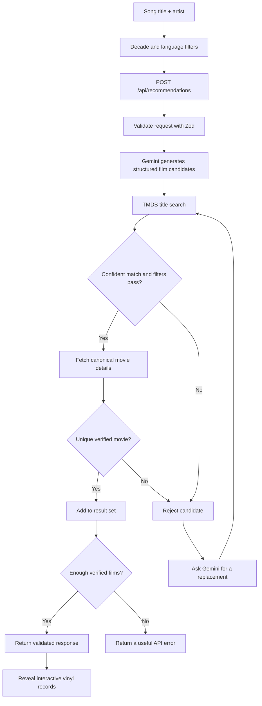

# PitchToPicture

**Live demo:** [pitch-to-picture.vercel.app](https://pitch-to-picture.vercel.app/)

**Song in. Cinema out.**

PitchToPicture turns a song title and artist into a curated set of films with a similar emotional atmosphere. It uses Gemini to choose film candidates, checks those candidates against TMDB, and presents the verified films as interactive 3D vinyl records.

The app is built around one idea: a film can feel like a song even when its plot, genre, and subject have nothing in common.

## Preview

The vinyl interaction is shown below. The screenshots cover the landing page, filter experience, and recommendation results.



| Landing page | Movie recommendations |
| --- | --- |
|  |  |
| Decade selection | Language selection |
|  |  |

> **How song interpretation works:** PitchToPicture does not play, upload, or analyze audio. Gemini interprets the supplied title and artist using its available knowledge. The app does not calculate tempo, key, instrumentation, lyrics, or other audio features.

## What the app does

1. Collects a song title and artist.
2. Lets the user narrow the film search by release decade and original language. Leaving either filter open allows any value in that category.
3. Sends the song and selected filters to a server-side Gemini request. The prompt asks Gemini to interpret the song's emotional character and return distinct real-film candidates in a structured format.
4. Checks each candidate against TMDB. A candidate must have a sufficiently strong title match, an unambiguous best result, and satisfy any selected year and language filters.
5. Requests replacement candidates when a suggestion cannot be verified or duplicates an accepted film. Replacement work is bounded; the service does not retry indefinitely.
6. Returns verified movie records to the client. The results view reveals them in sequence and keeps the full collection available to explore.

Gemini initially returns six candidates. The API can return **4 to 7 verified films**, with a target of 6. The number can be lower than the number Gemini initially suggests because TMDB verification and the selected filters determine what can be shown. If fewer than four films can be verified, the API returns an error instead of filling the collection with unverified titles.

## The implementation

### Stack

| Area | Technology | Why it is here |
| --- | --- | --- |
| Application | Next.js 16 App Router, React 19, TypeScript | Server routes, page composition, and typed client interactions live in one application. |
| Song interpretation | Google Gemini via `@google/genai` | Generates film candidates from the song title, artist, and selected filters. |
| Movie catalogue | TMDB API | Resolves candidate identities and supplies canonical movie details and artwork. |
| Validation | Zod 4 | Validates incoming requests, Gemini's structured output, and the final API response at runtime. |
| Styling | Global CSS and CSS Modules | Global atmosphere and page layout sit alongside isolated component styling. |
| Tests and lint | Node.js test runner, ESLint | Exercises service behavior and checks the codebase without adding a separate test framework. |

### Request flow



### The parts that matter

**Gemini is responsible for the creative choice.** The prompt asks the model to interpret the song's emotional fingerprint, then translate that feeling into cinema through mood, relationships, character journeys, pacing, imagery, and atmosphere. It explicitly warns against inventing musical details or choosing films only because their plot resembles the lyrics. The model returns structured candidate titles and years; the UI does not present generated match explanations.

**TMDB is the source of truth for film data.** A Gemini response is only a suggestion. The verifier compares normalized titles, original titles, and release years, rejects ambiguous top matches, fetches the selected movie's details, and checks the chosen decade and original-language filters against TMDB's data. The displayed title, release date, overview, poster, and rating come from the verified TMDB record.

**Replacement attempts have a ceiling.** Failed, duplicate, or filter-incompatible candidates are excluded from the result set. The orchestrator asks Gemini for further candidates while it still needs films, but caps replacement attempts at 14. It also stops when the model cannot produce a usable replacement. This keeps a poor or obscure match from turning into an unbounded provider request loop.

**The vinyl is an interaction, not a media player.** Each result is rendered as a CSS 3D album sleeve with a record that rotates independently. Pointer input lets the user drag the album to inspect the reverse side, where the movie overview and metadata are displayed. The reveal is staggered, while the records remain in the page for normal scrolling and interaction. The waveform animation is decorative; it is not driven by song audio.

## Run it locally

### Requirements

- Node.js **20.9.0 or newer**
- npm
- A [Google AI Studio API key](https://aistudio.google.com/apikey)
- A [TMDB API key](https://www.themoviedb.org/settings/api)

### Setup

Clone the repository and install its dependencies:

```bash
git clone <repository-url>
cd pitchtopicture
npm install
```

Create your local environment file:

```bash
# macOS / Linux
cp .env.example .env.local

# Windows PowerShell
Copy-Item .env.example .env.local
```

Add the credentials to `.env.local`:

```dotenv
GEMINI_API_KEY=your_gemini_api_key
TMDB_API_KEY=your_tmdb_api_key
```

Start the development server:

```bash
npm run dev
```

Open [http://localhost:3000](http://localhost:3000).

Both keys are read by server-side code. Keep them out of client components, `NEXT_PUBLIC_` variables, commits, screenshots, and logs. `.env.local` is ignored by Git; `.env.example` is the safe template to commit.

## Useful commands

| Command | Purpose |
| --- | --- |
| `npm run dev` | Start the local development server. |
| `npm run build` | Create the production build. |
| `npm run start` | Run the production server after building. |
| `npm run lint` | Run ESLint across the repository. |
| `npm test` | Run the Node.js test suite. |
| `npx tsc --noEmit` | Check TypeScript types without emitting files. |

Run the full local checks before opening a pull request or shipping a change:

```bash
npm test
npm run lint
npx tsc --noEmit
npm run build
```
## API routes

| Route | Method | Responsibility |
| --- | --- | --- |
| `/api/recommendations` | `POST` | Validates song and filter input, runs the Gemini-to-TMDB pipeline, and returns verified movie records. |
| `/api/tmdb/languages` | `GET` | Returns TMDB's available original-language options for the filter UI. The server caches this list for six hours. |
| `/api/health` | `GET` | Returns a small health response for the application. |

A recommendation request has this shape:

```json
{
  "songTitle": "Space Song",
  "artist": "Beach House",
  "decades": [2010, 2020],
  "languages": ["en", "ja"]
}
```

`decades` and `languages` are arrays. An empty array means that filter is unrestricted. Decades use their starting year (for example, `1990` represents 1990 to 1999). Language values are TMDB ISO 639-1 codes.

## Project layout

<details>
<summary>View project structure</summary>

```text
assets/                       README screenshots and vinyl preview GIF
app/
  api/
    health/                  Health endpoint
    recommendations/         Main recommendation endpoint
    tmdb/languages/          Language options endpoint
  filters/                   Filter and results route
  globals.css                Global layout, typography, and visual system
  layout.tsx                 Root layout and page metadata
  page.tsx                   Song and artist entry page

components/
  filters/
    FilterExperience.tsx     Decade/language filters and request state
    VinylAwakening.tsx       Animated transition while recommendations load
    vinyl-awakening.module.css
  results/
    ResultsExperience.tsx    Staggered results reveal
    MovieCard.tsx            Result wrapper
    VinylAlbum.tsx           Interactive 3D vinyl and sleeve
    MovieArtwork.tsx         TMDB poster rendering and fallback
    results.module.css
    vinyl.module.css

services/
  gemini/
    client.ts                Server-side Gemini client
    recommendation-prompt.ts Song interpretation and film-selection prompt
    recommendations.ts      Structured candidate generation and validation
    client.test.mjs         Gemini client behavior tests
    recommendation-prompt.test.mjs Prompt behavior tests
  tmdb/
    client.ts                Server-side TMDB fetch and provider errors
    languages.ts             Cached language configuration
    search.ts                Movie search
    movie.ts                 Canonical movie details
    verify.ts                Candidate identity and filter verification
    verify.test.mjs          Candidate verification tests
  recommendations/
    orchestrator.ts          Gemini, TMDB, replacement, and result orchestration

schemas/                     Zod request, candidate, response, and movie schemas
  recommendations.ts
  movie.ts
types/                        TypeScript domain types
lib/                          Environment parsing, errors, logging, and utilities
config/
  gemini.ts                  Gemini model configuration
constants/                    Shared limits
  limits.ts
.env.example                 Required server-side environment variables
package.json                 Scripts and dependencies
```

</details>

## Current scope and limitations

- Song interpretation uses the title and artist supplied by the user. There is no audio upload, playback, beat detection, transcription, or audio-feature extraction.
- Gemini proposes film candidates. It does not supply trusted movie IDs, posters, ratings, or descriptions.
- TMDB verifies movie identity and provides movie metadata. It does not judge whether a film is an emotionally accurate match.
- The app does not currently include accounts, saved searches, a database, subscriptions, or a dedicated music metadata provider.
- Results depend on Gemini's knowledge of the track and on TMDB's catalogue. Obscure tracks, alternate titles, ambiguous films, provider outages, and API limits can reduce the number of results.
- The waveform and vinyl animations are decorative and do not synchronize with the song.
- A successful local build does not establish production readiness. Check current Gemini and TMDB access, quotas, terms, attribution requirements, and hosting limits before deployment.

## Attribution

Movie metadata and artwork are provided by [The Movie Database (TMDB)](https://www.themoviedb.org/). PitchToPicture uses the TMDB API but is not endorsed or certified by TMDB. Review and follow the current [TMDB API terms and attribution requirements](https://www.themoviedb.org/documentation/api) before public release.

Gemini is provided by [Google AI](https://ai.google.dev/). Model availability, API access, pricing, and usage limits are subject to Google's current terms.

[](https://nextjs.org/)
[](https://react.dev/)
[](https://www.typescriptlang.org/)
[](https://ai.google.dev/)
[](https://www.themoviedb.org/)